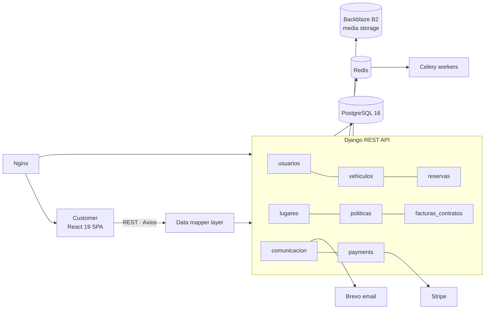

# Mobility4You — Vehicle Rental Platform

**Full-stack vehicle rental platform: online booking with real-time availability, Stripe payments, contract and invoice generation, and a complete back-office for fleet management.**


---

## Overview

Mobility4You lets customers search vehicles by location and dates, add extras, pay online and manage their booking, while the rental company manages fleet, pricing, contracts, invoices and customer communication from the Django admin.

The architecture was designed to be **white-label ready**: the React frontend talks to the API only through a dedicated *data mapper* layer, so the UI can be re-branded or replaced without touching the backend contract.

## Key features

| Area | What it does |
|---|---|
| **Booking engine** | Step-by-step reservation flow (vehicle → extras → confirmation → payment) with availability checks and conflict detection. |
| **Payments** | Stripe integration (backend payment intents + `@stripe/react-stripe-js` on the frontend). |
| **Contracts & invoices** | Automatic generation and storage of rental contracts and invoices. |
| **Fleet management** | Vehicle catalogue with image management, availability and maintenance tracking. |
| **Pricing & policies** | Per-vehicle rate periods, promotions, payment policies and cancellation penalties. |
| **Notifications** | Transactional emails (booking confirmation, updates) through Brevo. |
| **Back-office** | Custom Django admin per domain app (users, vehicles, bookings, locations, policies, billing, communication, payments). |
| **Async work** | Celery + Redis for background tasks and caching. |

## Architecture



- **8 domain apps** in the backend, each with its own models, serializers, views, permissions and admin.
- **Environment-specific settings** (`base`, `development`, `production`, `render`) with `django-environ`.
- **Static files** served by WhiteNoise; **media** stored on Backblaze B2 via `django-storages` + `boto3`.

## Tech stack

- **Backend:** Python, Django 5.1, Django REST Framework 3.16, django-filter, Celery, Gunicorn
- **Frontend:** React 19, React Router 7, React-Bootstrap, Axios, Stripe React SDK
- **Data:** PostgreSQL 16, Redis
- **Integrations:** Stripe, Brevo (email), Backblaze B2 (S3-compatible storage)
- **Infra:** Docker Compose (dev / prod / Render), Nginx reverse proxy, Prometheus config, Render.com

## Project structure

```
backend/
  config/settings/     base · development · production · render
  usuarios/ vehiculos/ reservas/ lugares/
  politicas/ facturas_contratos/ comunicacion/ payments/
  utils/               email service (Brevo), management commands
frontend/
  src/components/      catalogue, vehicle detail, booking steps, Stripe form
  src/services/        API services + dataMapper.js (frontend ⇄ API contract)
docker/                compose files per environment, nginx, redis, monitoring
documentation/         environment configuration and media storage notes
deploy.sh              one-command multi-environment deployment
```

## Getting started

**Requirements:** Docker and Docker Compose.

```bash
git clone https://github.com/OUABSL/Mobility4You.git
cd Mobility4You

# copy and fill the environment templates
cp backend/.env-example backend/.env
cp frontend/.env-example frontend/.env

./deploy.sh dev        # development stack with hot reload
```

| Service | URL |
|---|---|
| Frontend | http://localhost:3000 |
| API | http://localhost:8000/api/ |
| Django admin | http://localhost:8000/admin |

Other commands: `./deploy.sh prod` (local production stack with Nginx), `./deploy.sh logs`, `./deploy.sh status`, `./deploy.sh stop`.

### Deploying to Render

The repository includes `Dockerfile.render`, build scripts and `docker-compose.render-*.yml` to deploy the frontend as a static site and the backend as a web service with managed PostgreSQL. Environment variables are configured in the Render dashboard (see `documentation/ENVIRONMENT_CONFIGURATION.md`).

## API

Endpoints are grouped by domain under `/api/`:

`/api/usuarios/` · `/api/vehiculos/` · `/api/lugares/` · `/api/reservas/` · `/api/politicas/` · `/api/facturas_contratos/` · `/api/comunicacion/` · `/api/payments/`

## Tests

```bash
docker exec mobility4you_backend python manage.py test
```

## Roadmap

- CI pipeline (GitHub Actions) with backend tests and frontend build
- Token-based authentication for third-party clients
- White-label theming configuration

## Author

**Ouael Boussiali** — AI Engineer · [LinkedIn](https://www.linkedin.com/in/ouael-boussiali/) · [GitHub](https://github.com/OUABSL)
